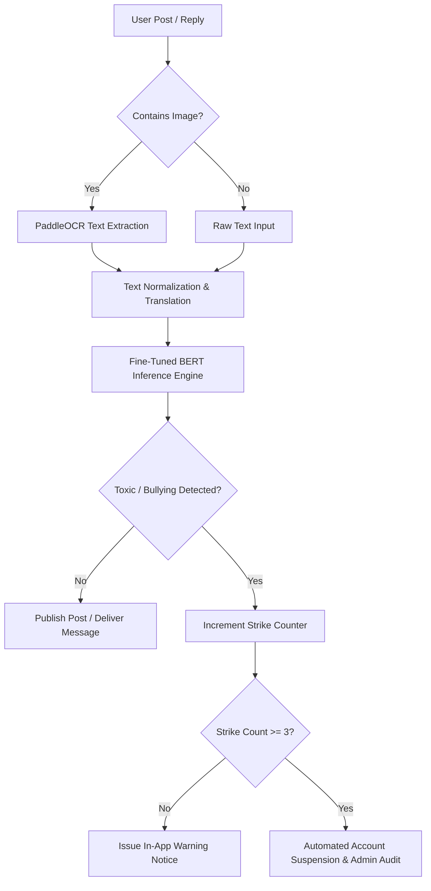

<div align="center">

# 🛡️ Multimodal Cyberbullying Detection & Moderation System
### *Real-Time Multimodal Content Moderation Using BERT & PaddleOCR*

[](https://www.python.org/)
[](https://flask.palletsprojects.com/)
[](https://huggingface.co/)
[](https://github.com/PaddlePaddle/PaddleOCR)
[](LICENSE)
[]()

<p align="center">
  A full-stack, AI-driven content moderation platform engineered to detect and mitigate cyberbullying across social media streams. Combines fine-tuned bidirectional encoder representations (BERT) with optical character recognition (PaddleOCR) to identify abusive text and toxic image memes—including mixed vernacular/transliterated dialect.
</p>

[Key Features](#-key-features) •
[Architecture](#-system-architecture) •
[Tech Stack](#-technology-stack) •
[Installation](#-quickstart--installation) •
[Project Structure](#-project-structure) •
[License](#-license)

</div>

---

## 📌 Overview

Traditional cyberbullying filters rely heavily on static keyword blacklists that are easily bypassed using character substitutions, image-based text memes, and vernacular phonetic spellings (e.g., Tanglish/Tamil-English code-mixed dialects). 

This platform addresses these limitations through an intelligent multimodal pipeline:
1. **Visual Content**: Optical Character Recognition via **PaddleOCR** extracts text embedded in memes and image posts.
2. **Linguistic Preprocessing**: Automated transliteration normalization and multi-language translation ensure standardized semantic tokens.
3. **Deep Language Classification**: Fine-tuned **BERT** transformers evaluate contextual hostility and toxicity.
4. **Automated Enforcement**: An automated 3-strike governance policy provides instant in-app user warnings and programmatic account lockouts upon repeated violations.

---

## ✨ Key Features

- **Multimodal Text & Meme Detection**: Jointly evaluates user-submitted posts, text replies, and image attachments.
- **Vernacular & Slang Normalization**: Preprocessing layer normalizes colloquial spelling and transliterated vernacular expressions prior to inference.
- **Automated 3-Strike Moderation**:
  - `Strike 1`: Contextual warning notification detailing the flagged utterance.
  - `Strike 2`: Escalated disciplinary notice.
  - `Strike 3`: Immediate automated account suspension and administrative lockdown.
- **Interactive Admin Oversight Panel**: Real-time dashboard for administrators to inspect flagged tweets, review evidence logs, and manually override account penalties.
- **Multilingual Notification Dispatch**: Automated dynamic translation converts system alerts into the user's native preferred language.

---

## 🏗️ System Architecture



---

## 💻 Technology Stack

| Layer | Technologies |
|---|---|
| **Deep Learning & NLP** | Hugging Face Transformers, BERT, PyTorch / TensorFlow |
| **Computer Vision** | PaddleOCR, OpenCV, Pillow (PIL), PyTesseract |
| **Backend Framework** | Python 3, Flask, Werkzeug |
| **Translation & Linguistics** | Deep Translator (`deep-translator`), LangDetect |
| **Database & Storage** | SQLite3, File System Static Storage |
| **Frontend** | HTML5, CSS3, JavaScript, Jinja2 Templates |

---

## 🚀 Quickstart & Installation

### Prerequisites
* Python 3.9 or higher
* [Git](https://git-scm.com/)
* Optional: CUDA-enabled GPU for accelerated BERT inference

### 1. Clone the Repository
```bash
git clone https://github.com/shamjoes/CYBER-BULLY-UNMASKING-USING-BERT-AND-OCR-MODEL-.git
cd CYBER-BULLY-UNMASKING-USING-BERT-AND-OCR-MODEL-
```

### 2. Set Up a Virtual Environment
```bash
# Windows
python -m venv venv
venv\Scripts\activate

# macOS/Linux
python3 -m venv venv
source venv/bin/activate
```

### 3. Install Dependencies
```bash
pip install --upgrade pip
pip install -r requirements.txt
```

### 4. Run the Application
```bash
python app.py
```
Open your browser and navigate to:
```
http://localhost:5000
```

> **Default Admin Credentials:**
> - **Username:** `admin`
> - **Password:** `admin@123`

---

## 📂 Project Structure

```text
├── app.py                  # Core Flask server and route orchestration
├── bert_predict.py         # BERT model inference pipeline
├── requirements.txt        # Python dependency manifest
├── LICENSE                 # MIT Open-Source License
├── .gitignore              # Git exclusions for cache and binaries
├── cyberbully.db           # SQLite database schema and records
├── static/
│   └── uploads/            # Temporary media storage for image analysis
└── templates/              # Jinja2 frontend views
    ├── login.html          # Authentication entrypoint
    ├── signup.html         # User registration with language preference
    ├── dashboard.html      # Feed view with post and reply capabilities
    ├── messages.html       # Direct notification inbox & warning alerts
    └── admin.html          # Administrative audit panel and user moderation
```

---

## 🛡️ License

Distributed under the **MIT License**. See [`LICENSE`](LICENSE) for full details.

---

<div align="center">
  Developed with ❤️ by <a href="https://github.com/shamjoes">Sham</a>
</div>